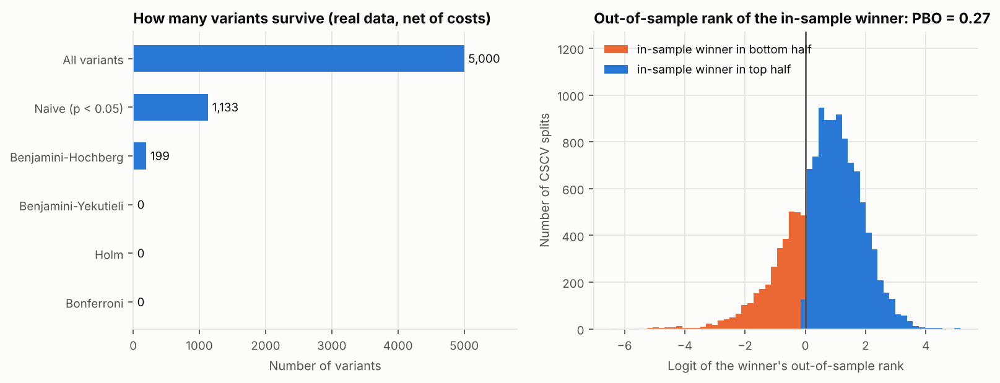

# Overfit Lab: how many backtests survive honest testing?

**Headline.** Of 5,000 trading-strategy variants backtested on 10 crypto assets (2018-07-01 to 2026-11-15, net of costs), 1,028 look significant when tested one at a time at 5%, 34 survive Benjamini-Hochberg, and **0 survive Holm**.
The best variant has an annualised Sharpe ratio of 1.36, but luck alone is expected to produce 1.53: its **Deflated Sharpe Ratio is 0.30** (0.95 needed), Hansen's SPA p-value is 0.15, and the **Probability of Backtest Overfitting is 0.22**.
Measured against simply holding each coin, 0 variants earn significantly more even before any correction. Data: REAL - Binance spot OHLCV (data.binance.vision).

> No variant survives: after correcting for the search, the best backtest is indistinguishable from the luckiest of many skill-less strategies.



*Left: how many of the 5,000 variants are still significant after each multiple-testing correction. Right: the CSCV logit distribution; mass to the left of zero means the in-sample winner ended up in the bottom half out of sample.*

[](https://github.com/sunghyunsaha/overfit-lab/actions/workflows/ci.yml)

## The question

If you search thousands of trading-strategy variants on historical data and pick the best one, how much of its performance is real and how much is selection luck?

This repository is a small research framework that answers the question end to end:

1. generate a large family of strategies (five rule families, a volatility-target overlay, 5,000 variants);
2. backtest them with a hand-written vectorised backtester (next-bar execution, fees, volatility-dependent slippage);
3. put every variant's daily returns in one T x N matrix;
4. run the modern overfitting diagnostics on that matrix and count what survives.

Every number in this file and in [REPORT.md](REPORT.md) is written by the pipeline from `reports/results/*.json`; none is typed by hand.

## Results at a glance

| Experiment | Question | Result |
|---|---|---|
| **E1** Null world | On synthetic data with no signal, do the tools stay quiet? | Naively, 179 of 5,000 skill-less variants (3.6%) look significant. After Holm: 0. After Benjamini-Hochberg: 0. Over 200 fat-tailed null worlds, Holm made a false discovery in 1.5% of them, SPA rejected in 1.5% and the DSR passed in 0.0% (nominal level 5%). |
| **E2** Power | How strong must a real signal be to be detected? | SPA reaches 50% detection at an oracle Sharpe of about 2.5 (true net Sharpe of the best variant about 0.8); Holm reaches 50% detection at an oracle Sharpe of about 2.4 (true net Sharpe of the best variant about 0.8); the DSR as defined in the paper never reaches 50% detection in the tested range (up to 4). |
| **E3** Real data | What survives on crypto? | 0 of 5,000 after Holm; PBO 0.22; DSR of the best 0.30; walk-forward Sharpe -0.31 against 2.18 in the selection windows. |
| **E3 hourly** | The same rules on 1-hour bars? | Before costs 20 variants survive Holm against cash (SPA p = 0.00); after costs 0 do and the median net Sharpe is -0.66. Against buy-and-hold, 0 survive Benjamini-Hochberg before costs and 0 after. |
| **E4** Costs | Does the conclusion depend on fees (0 to 30 bps)? | There are 0 Holm survivors at every fee level; the best net Sharpe goes from 1.39 to 1.33. |
| **E5** Robustness | Does it depend on folds, embargo, period, block length? | PBO stays between 0.18 and 0.25 for 6 to 16 CSCV blocks; the SPA p-value stays between 0.11 and 0.15 across block lengths; no sub-period has a single Holm survivor. |

One finding came from validating the tools rather than from the data: plugging the in-sample skewness into the Probabilistic Sharpe Ratio and applying Bonferroni produced false discoveries in 14% of Gaussian null worlds (5% allowed). The per-variant tests therefore use the classical t-test instead. The choice matters for the headline and is stated here for that reason: with the PSR-based p-values, 1 of the 5,000 variants would pass Holm and 247 would pass Benjamini-Hochberg. The cause and the fix are described in [REPORT.md](REPORT.md) sections 5.1 and 5.3 and in [DECISIONS.md](DECISIONS.md).

## Data used

**E3, E4 and E5 use: REAL - Binance spot OHLCV (data.binance.vision).**

- This run uses the project's primary source: Binance spot OHLCV bulk data from `data.binance.vision`, which are one exchange's own bars (open, high, low, close, volume). The downloader verifies each archive against the SHA-256 checksum file that Binance publishes beside it. Sample: 3,060 daily bars per asset, 2018-07-01 to 2026-11-15.
- The hourly row above uses: REAL - Binance spot OHLCV (data.binance.vision), 73,440 one-hour bars per asset, 2018-07-01 to 2026-11-15. It is produced by `make hourly`, not by `make all`.
- `make all` uses the Binance cache if it exists, otherwise the CoinMetrics cache, otherwise a synthetic stand-in, and prints which one it used. The source is also recorded in `reports/results/e3.json` and in this section.
- **E1 and E2 are synthetic by design** (they need a known ground truth).
- The market data itself is not in the repository (`data/` is git-ignored). `make data` downloads it again. How the committed run obtained it is described in [DECISIONS.md](DECISIONS.md), A1.

## How to reproduce

```bash
python -m venv .venv && source .venv/bin/activate
make install          # pinned dependencies (tested on Python 3.11, 3.12 and 3.13)
make test             # full test suite
make demo             # under 2 minutes, small synthetic sample -> reports/demo/
make data-check       # 10-second check that Binance is reachable and every symbol has data
make data             # Binance OHLCV -> data/   (or: make data-fallback for CoinMetrics)
make all              # E1-E5, figures, README.md and REPORT.md re-rendered from results
make data-hourly && make hourly   # optional: E3 on 1-hour Binance bars -> reports/hourly/
```

Runs are driven by YAML (`configs/base.yaml` plus an override file) and a fixed seed, so the same config gives the same numbers. `make figures` redraws every figure from saved results without recomputing, and `make docs` re-renders the documents. On a two-core machine the full run takes roughly 10 to 12 minutes and the hourly run under 2.

**Without `make` (for example on Windows).** Every target is one Python command, listed in the `Makefile`. After `pip install -r requirements.txt` and `pip install -e . --no-deps`:

```
python -m pytest
python -m overfitlab.cli all --config configs/demo.yaml
python -m overfitlab.cli check-data --config configs/full.yaml
python -m overfitlab.cli download --config configs/full.yaml --source binance
python -m overfitlab.cli all --config configs/full.yaml
python -m overfitlab.cli download --config configs/hourly.yaml --source binance
python -m overfitlab.cli e3 --config configs/hourly.yaml
python -m overfitlab.cli docs --config configs/full.yaml
```

## Repository map

```
configs/                 base.yaml (every knob), full.yaml, demo.yaml, hourly.yaml
src/overfitlab/
  data/                  synthetic.py (GBM, GARCH, planted signal), binance.py, coinmetrics.py, loader.py
  backtest/              indicators.py, strategies.py, engine.py (the backtester), universe.py (T x N matrix)
  diagnostics/           sharpe.py (PSR, DSR, MinTRL, MinBTL), trials.py (effective N), pbo.py (CSCV),
                         cv.py (purged k-fold, CPCV), bootstrap.py (Reality Check, SPA),
                         multiple.py (Bonferroni, Holm, BH, BY, haircut), walkforward.py
  experiments/           common.py (the diagnostic pipeline), e1_null.py ... e5_robustness.py
  reporting/             figures.py, render.py (templates -> documents)
  cli.py                 python -m overfitlab.cli <download|check-data|e1..e5|all|figures|docs>
tests/                   lookahead, hand-calculated backtest, paper numbers, purging, brute-force PBO, ...
docs/templates/          README / REPORT / INTERVIEW_PREP templates with placeholders for pipeline numbers
reports/results/         one JSON per experiment (the single source of every reported number)
reports/figures/         all figures
reports/hourly/          results and figures of the optional hourly run
```

## Documents

| File | What it is |
|---|---|
| [REPORT.md](REPORT.md) | Paper-style write-up: data, methods with equations, experiments, results, limitations, references |
| [LEARNING.md](LEARNING.md) | Study guide for every module: plain language, maths, code walkthrough, common mistakes, interview questions, self-quiz |
| [INTERVIEW_PREP.md](INTERVIEW_PREP.md) | Two-minute summary, the 15 hardest questions with answers, weakest points |
| [DECISIONS.md](DECISIONS.md) | Every non-obvious design choice, the alternatives, and why |
| [LIMITATIONS.md](LIMITATIONS.md) | What this project does not show |
| [NEXT_STEPS.md](NEXT_STEPS.md) | Unfinished items, known issues, extensions |

## Tests that matter

- **Lookahead:** replacing all data after bar t leaves every signal, position and return up to t bit-for-bit unchanged, for all 500 variants per asset (`tests/test_lookahead.py`).
- **Backtester:** a five-bar example worked out by hand (`tests/test_engine.py`).
- **PSR / DSR / MinBTL:** the worked example of Bailey and Lopez de Prado (2014) (SR0 = 0.1132, DSR = 0.9004) and the "45 trials for 5 years" example of Bailey et al. (2014) (`tests/test_sharpe.py`).
- **PBO:** equality with an independent brute-force implementation, plus known-answer cases (`tests/test_pbo.py`).
- **Purging and embargo:** brute-force check that no training observation overlaps a test label window (`tests/test_cv.py`).
- **Reality Check / SPA:** size under the null, power, and the closed-form variance against the bootstrap variance (`tests/test_bootstrap.py`).
- **Multiple testing:** agreement with `statsmodels` (`tests/test_multiple.py`).
- **Downloader:** the real download code run over HTTP against a local replica of the Binance site: 404s, checksums, both timestamp formats, the month cache, the daily-file fallback (`tests/test_binance_replica.py`).
- **Documents:** the committed README and REPORT equal the templates rendered from the committed results (`tests/test_docs.py`).
