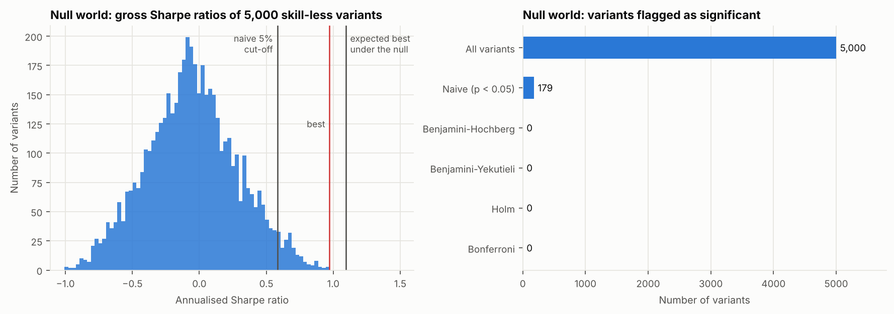
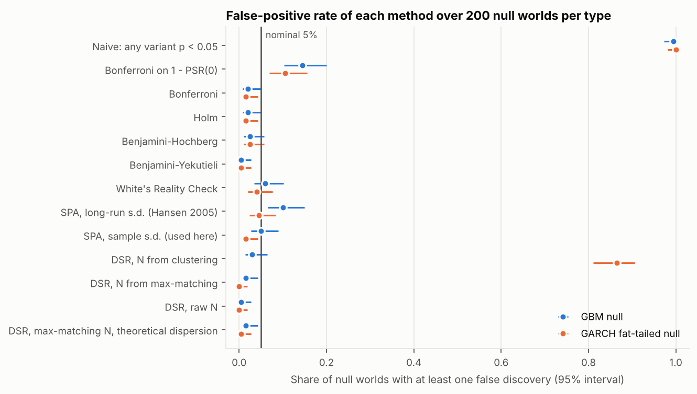
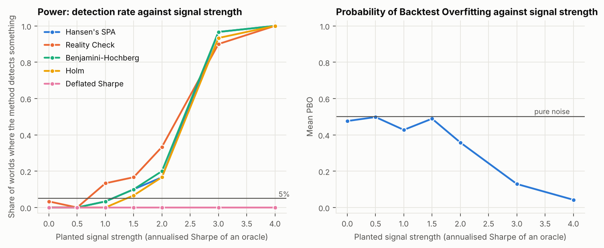
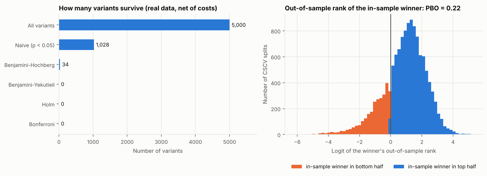
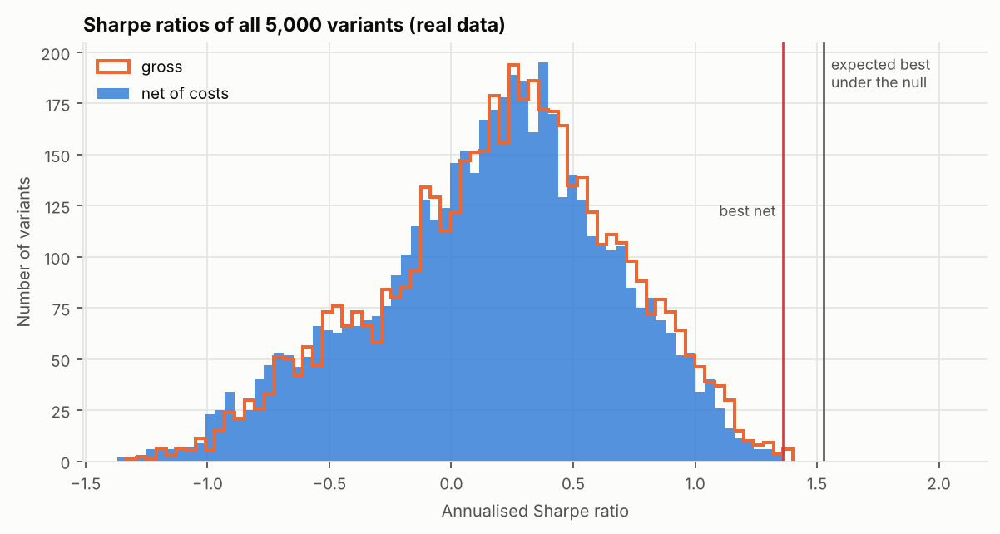
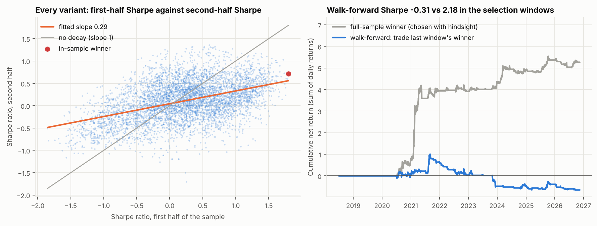
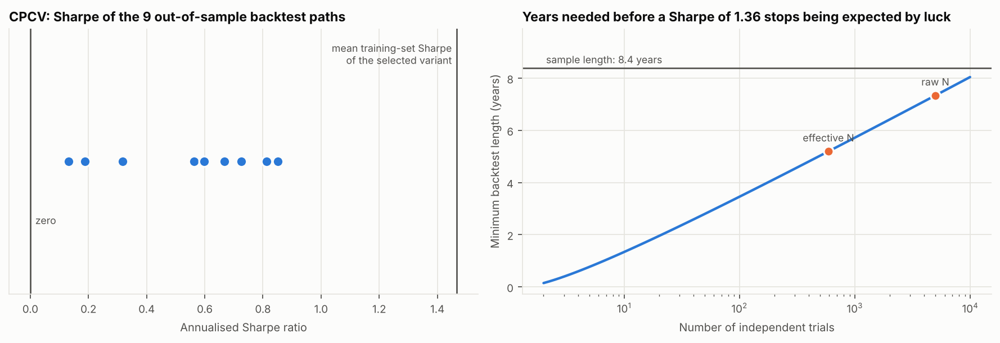
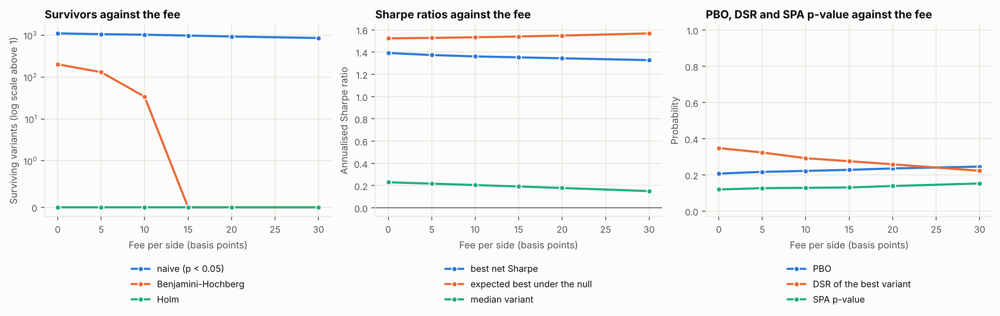
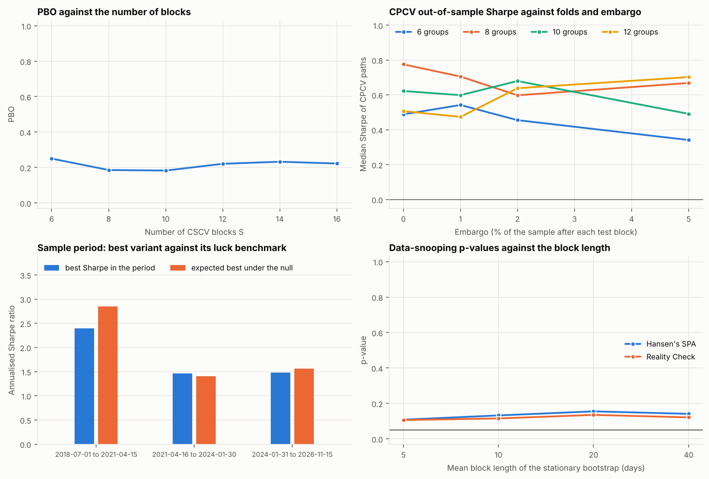
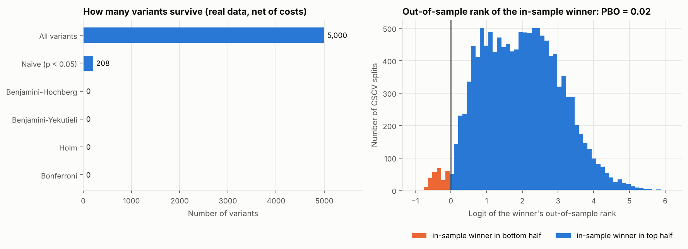

# How many backtests survive honest testing?

*A study of selection bias in systematic trading-strategy research.*

**Data used for the empirical results (E3 to E5): REAL - Binance spot OHLCV (data.binance.vision).** Experiments E1 and E2 are synthetic by design. Every number and table in this report is written by the pipeline from `reports/results/*.json`. The prose that interprets them was written for the committed run; if you re-run on other data, re-read it against the regenerated tables.

## Abstract

We generate 5,000 variants of five classic technical trading rules on 10 crypto assets, backtest them net of costs on 8.4 years of daily data, and ask how many remain statistically convincing once the search itself is accounted for. Tested one at a time at the 5% level, 1,028 variants (20.6%) look significant. After Holm's correction 0 remain; after Benjamini-Hochberg 34. The best variant's annualised Sharpe ratio of 1.36 is below what the best of that many skill-less strategies is expected to show (1.53), giving a Deflated Sharpe Ratio of 0.30. Hansen's SPA test does not reject the hypothesis that no variant has positive expected return (p = 0.15), and the Probability of Backtest Overfitting is 0.22. Measured against buy-and-hold of the same coin instead of cash, 0 variants earn significantly more even before correction. On one-hour bars the same rules look better before costs (20 survive Holm against cash) and worse after them (0 survive, median net Sharpe ratio -0.66). The same tools are first validated on synthetic markets with no signal, where they should stay silent, and on markets with a planted signal, where they should not. That validation exposed two finite-sample problems in textbook recipes (section 5.1). Both were corrected on the evidence of the synthetic worlds alone, and the real-data results are shown with the original and the corrected versions side by side. One of the two matters for the headline: with the original p-values 1 of the 5,000 variants would pass Holm (section 5.3).

## 1. Introduction

A backtest answers the question "how would this rule have done?" A research process asks that question thousands of times and reports the best answer. The best of many noisy estimates is biased upwards even when every underlying strategy is worthless, so the reported Sharpe ratio of a selected strategy overstates what an investor should expect. Bailey, Borwein, Lopez de Prado and Zhu (2014) call the result "pseudo-mathematics": with enough trials, any Sharpe ratio can be manufactured from noise.

This project measures the size of that effect in a controlled setting. It has three parts:

1. a transparent strategy factory and backtester that produce one T x N matrix of daily returns (section 3);
2. implementations, from the original papers, of the main diagnostics for selection bias (section 4);
3. five experiments (section 5): a null world (E1), a power study (E2), real data (E3), cost sensitivity (E4) and robustness (E5).

The contribution is not a trading strategy. It is a worked demonstration, with tests, of how much of a "best backtest" survives when the search is counted honestly, and of how the diagnostic tools themselves behave when the truth is known.

## 2. Data

### 2.1 Real data

Source for this run: **REAL - Binance spot OHLCV (data.binance.vision)**. Assets: 10 large, long-lived coins. Sample: 2018-07-01 to 2026-11-15, 3,060 daily bars per asset, aligned on a common calendar.

This run uses the project's primary source: Binance spot OHLCV bulk data from `data.binance.vision`, which are one exchange's own bars (open, high, low, close, volume). The downloader verifies each archive against the SHA-256 checksum file that Binance publishes beside it.

Buy-and-hold over the sample, for context:

| Asset | Buy-and-hold Sharpe | Annualised volatility | Total return |
|---|---|---|---|
| BTC | 0.76 | 61% | +928% |
| ETH | 0.62 | 82% | +306% |
| BNB | 0.94 | 83% | +4053% |
| XRP | 0.57 | 100% | +111% |
| ADA | 0.50 | 99% | +9% |
| LTC | 0.37 | 88% | -43% |
| TRX | 0.71 | 86% | +733% |
| XLM | 0.44 | 102% | -29% |
| ETC | 0.37 | 99% | -62% |
| NEO | 0.16 | 101% | -95% |

The loader validates every asset and logs each finding (`reports/results/data_validation.json`). Duplicated timestamps are dropped, missing bars are filled flat at the previous close with zero volume, inconsistent highs and lows are widened, and outliers (daily log returns above 12 robust standard deviations) are logged but left unchanged, because large moves in crypto are usually real. Counts for this run:

| Check | Bars affected (all assets) |
|---|---|
| duplicates | 0 |
| bad prices | 0 |
| gaps | 0 |
| ohlc inconsistent | 0 |
| zero volume | 0 |
| outliers | 31 |

### 2.2 Synthetic data

Synthetic markets give a known ground truth. For asset i and bar t the simple return is

```math
R_{i,t} = \mu_{i,t} + \sigma_{i,t} z_{i,t}, \qquad z_{i,t} = \sqrt{\rho}\, f_t + \sqrt{1-\rho}\, e_{i,t}
```

with a common factor f (assets are correlated, as coins are). Three generators are used:

- **GBM:** constant volatility, Gaussian shocks.
- **GARCH:** $`\sigma^2_{i,t} = \omega + \alpha\,\varepsilon^2_{i,t-1} + \beta\,\sigma^2_{i,t-1}`$ with standardised Student-t shocks (6 degrees of freedom), giving volatility clustering and fat tails.
- **Planted signal:** $`\mu_{i,t} = s\,\sigma_{i,t}\,x_{i,t}`$ where x is a hidden AR(1) state with unit variance and a half-life of 20 bars. The strength is reported as the annualised Sharpe ratio $`s\sqrt{365}`$ an oracle that sees x would earn.

With no signal and no drift the conditional mean of the simple return is exactly zero, so prices are a martingale and every strategy that only uses past data has a true gross Sharpe ratio of exactly zero. That property is what makes E1 a clean test.

## 3. Strategy universe and backtester

### 3.1 Universe

Five rule families, each with a parameter grid, give 250 base variants per asset. Each is run with and without a volatility-target overlay (position scaled by target volatility over trailing realised volatility, capped at 2), giving 500 variants per asset and 5,000 in total.

| Family | Rule | Base variants per asset |
|---|---|---|
| Moving-average crossover | long when the fast average is above the slow one; SMA or EMA | 68 |
| Time-series momentum | sign of the trailing return over a lookback | 26 |
| Z-score mean reversion | fade deviations of the log price from its rolling mean, with entry and exit thresholds | 80 |
| Donchian breakout | enter on a new N-bar high or low, exit on a shorter channel | 28 |
| RSI thresholds | Wilder's RSI, reversal or trend style | 48 |

Each rule exists in a long-only and a long-short version.

### 3.2 Backtester

The backtester is about forty lines of NumPy (`backtest/engine.py`). A strategy decides a target position $`w_t`$ at the close of bar t using data up to and including bar t. The position is held during the next bar:

```math
\text{held}_t = w_{t-1}, \qquad g_t = \text{held}_t\, r_t, \qquad r_t = \frac{C_t}{C_{t-1}} - 1 .
```

Trading from the previous holding to the new one is charged to the bar in which the new position starts:

```math
\text{net}_t = g_t - |\text{held}_t - \text{held}_{t-1}|\,\bigl(\text{fee} + k\,\hat\sigma^{\text{daily}}_{t-1}\bigr).
```

The fee is 10 basis points per side and slippage is 0.01 times the trailing 20-day volatility, measured up to the bar before the trade. Gross returns, turnover and slippage are stored as three T x N matrices, so net returns for any fee are a linear combination and all diagnostics read the same data. A test replaces all data after an arbitrary bar and checks that every signal, position and return up to that bar is unchanged (`tests/test_lookahead.py`).

## 4. Methods

Throughout, SR denotes a per-period (daily) Sharpe ratio, mean over standard deviation with a zero risk-free rate; annualised values multiply by $`\sqrt{365}`$. T is the number of daily observations and N the number of variants.

### 4.1 Probabilistic Sharpe Ratio

The Sharpe estimator has standard error (Mertens 2002; Bailey and Lopez de Prado 2012)

```math
\hat\sigma(\widehat{SR}) = \sqrt{\frac{1 - \hat\gamma_3 \widehat{SR} + \frac{\hat\gamma_4 - 1}{4}\widehat{SR}^2}{T-1}}
```

where $`\hat\gamma_3`$ is the skewness and $`\hat\gamma_4`$ the kurtosis of the returns. The Probabilistic Sharpe Ratio is the confidence that the true Sharpe ratio exceeds a benchmark $`SR^*`$:

```math
PSR(SR^*) = \Phi\!\left(\frac{\widehat{SR} - SR^*}{\hat\sigma(\widehat{SR})}\right).
```

For the per-variant p-values that feed the multiple-testing corrections we use the standard error under the null hypothesis, $`p = 1 - \Phi(\widehat{SR}\sqrt{T-1})`$, which is the classical t-test. The reason is an empirical finding reported in section 5.1.

### 4.2 Expected maximum Sharpe ratio and the Deflated Sharpe Ratio

If N independent strategies all have zero true Sharpe ratio and their estimates have standard deviation $`\sqrt{V}`$, the expected value of the largest estimate is approximately (Bailey and Lopez de Prado 2014)

```math
SR_0 = \sqrt{V}\left[(1-\gamma)\,\Phi^{-1}\!\left(1-\frac{1}{N}\right) + \gamma\,\Phi^{-1}\!\left(1-\frac{1}{N e}\right)\right]
```

with $`\gamma \approx 0.5772`$ the Euler-Mascheroni constant. The Deflated Sharpe Ratio is the PSR measured against that benchmark, $`DSR = PSR(SR_0)`$, using the selected strategy's own skewness and kurtosis. V is the cross-sectional variance of the N Sharpe estimates, as in the paper. A DSR above 0.95 says the selected strategy is significantly better than the best of N lucky draws.

### 4.3 Effective number of independent trials

The variants are highly correlated, so N in the formula above should not be the raw count. Four estimators are computed from the correlation matrix C of the variants' returns (`diagnostics/trials.py`):

- **Average correlation** (Bailey and Lopez de Prado 2014): $`N_{\text{eff}} = \bar\rho + (1-\bar\rho)N`$.
- **Clustering**: hierarchical clustering on the distance $`\sqrt{(1-C_{ij})/2}`$, with the number of clusters chosen by the silhouette quality score. This is a simplified form of the ONC algorithm of Lopez de Prado and Lewis (2019): average linkage replaces repeated k-means and there is no recursive refinement.
- **Eigenvalues**: the participation ratio $`N^2 / \lVert C \rVert_F^2`$.
- **Max-matching** (this project): simulate $`z \sim \mathcal{N}(0, C)`$, average $`\max_k z_k`$, and solve for the number of independent normals with the same expected maximum. This applies the definition directly: the N that reproduces the expected maximum of the correlated family.

Section 5.1 compares their predictions with the realised maximum in null worlds. Max-matching is used for the headline DSR; the others are reported.

### 4.4 Probability of Backtest Overfitting

Combinatorially Symmetric Cross-Validation (Bailey, Borwein, Lopez de Prado and Zhu 2017) cuts the T rows into S contiguous blocks and considers every way of assigning half of them to an in-sample set and the rest to an out-of-sample set. For each of the $`\binom{S}{S/2}`$ splits, the variant with the best in-sample Sharpe ratio is found and its out-of-sample rank among all N variants is expressed as a relative rank $`\bar\omega \in (0,1)`$ and a logit

```math
\lambda = \ln\frac{\bar\omega}{1-\bar\omega}, \qquad PBO = \Pr[\lambda \le 0].
```

PBO is the fraction of splits in which the in-sample winner falls in the bottom half out of sample. Selection on pure noise gives about 0.5. We use S = 16 (12,870 splits).

### 4.5 Purged k-fold and Combinatorial Purged Cross-Validation

Here the "model" is the rule "trade the variant with the best training-set Sharpe ratio". Following Lopez de Prado (2018, chapters 7 and 12), training observations whose information window overlaps the test set are purged, and an embargo removes further observations after each test block. With N groups and k test groups there are $`\binom{N}{k}`$ splits and they recombine into $`\binom{N-1}{k-1}`$ backtest paths, each covering the whole sample out of sample. We use 10 groups with 2 test groups (45 splits, 9 paths), a purge horizon of 20 bars and an embargo of 31 bars. A test checks by brute force that no training observation overlaps a test window (`tests/test_cv.py`).

### 4.6 Reality Check and SPA

White's (2000) Reality Check tests $`H_0: \max_k E[d_k] \le 0`$, where $`d_k`$ is the return of variant k in excess of the benchmark (cash). The statistic is $`V = \max_k \sqrt{T}\,\bar d_k`$ and its null distribution is approximated with the stationary bootstrap of Politis and Romano (1994), which resamples blocks of rows with geometric lengths (mean 10 days, 1,000 resamples), keeping both cross-sectional and short-range time dependence:

```math
V^*_b = \max_k \sqrt{T}\,(\bar d^*_{k,b} - \bar d_k), \qquad p = \frac{1}{B}\sum_b 1\{V^*_b > V\}.
```

Hansen's (2005) SPA test studentises the statistic and re-centres the bootstrap so that clearly poor strategies do not inflate the null distribution:

```math
T^{SPA} = \max\Bigl(\max_k \frac{\sqrt{T}\,\bar d_k}{s_k},\,0\Bigr), \qquad g_c(\bar d_k) = \bar d_k\,1\Bigl\{\bar d_k \ge -s_k\sqrt{\tfrac{2\ln\ln T}{T}}\Bigr\}.
```

We report the consistent p-value. One deviation from the paper: Hansen sets $`s_k`$ to an estimate of the long-run standard deviation; we use the sample standard deviation and report the long-run version alongside, for the reason measured in section 5.1.

### 4.7 Multiple-testing corrections and the haircut Sharpe ratio

Per-variant p-values are adjusted with Bonferroni and Holm (1979), which control the family-wise error rate, and with Benjamini-Hochberg (1995) and Benjamini-Yekutieli (2001), which control the false discovery rate. Implementations are checked against `statsmodels`. The haircut Sharpe ratio of Harvey and Liu (2015) converts the best variant's Sharpe ratio to a p-value, adjusts it, and converts back. Simplification: Harvey and Liu simulate the unobserved tests from a fitted model; here all tests are observed, so the actual p-values are used.

### 4.8 Minimum Backtest Length

Bailey, Borwein, Lopez de Prado and Zhu (2014) show that with N independent skill-less trials an annualised Sharpe ratio of $`\overline{SR}`$ is expected in sample unless the backtest is longer than

```math
MinBTL \approx \left(\frac{(1-\gamma)\,\Phi^{-1}(1-\frac{1}{N}) + \gamma\,\Phi^{-1}(1-\frac{1}{Ne})}{\overline{SR}}\right)^2 < \frac{2\ln N}{\overline{SR}^2}\ \text{years}.
```

### 4.9 Naive selection and walk-forward

As a baseline, the variant with the best Sharpe ratio over a trailing 730-day window is traded for the next 90 days, rolling forward. We also compare every variant's Sharpe ratio in the first and second halves of the sample.

## 5. Experiments and results

### 5.1 E1: null world

**Setup.** One full-size world (10 assets, 2,900 daily bars, GARCH with fat tails, no signal) and a Monte Carlo of 200 smaller worlds per null type (1,000 variants, 2,000 bars each). Gross returns are used in the Monte Carlo because with costs every true Sharpe ratio is negative and the null holds with room to spare.

**Full-size world.** The best of 5,000 skill-less variants has an annualised gross Sharpe ratio of 0.97 and an uncorrected PSR(0) of 0.9971.

| Test on each variant | Gross: survivors | Gross: share | Net: survivors | Net: share |
|---|---|---|---|---|
| Naive: p < alpha, no correction | 179 | 3.6% | 149 | 3.0% |
| Benjamini-Hochberg (FDR) | 0 | 0.0% | 0 | 0.0% |
| Benjamini-Yekutieli (FDR, any dependence) | 0 | 0.0% | 0 | 0.0% |
| Holm (FWER) | 0 | 0.0% | 0 | 0.0% |
| Bonferroni (FWER) | 0 | 0.0% | 0 | 0.0% |

| Quantity | Gross | Net |
|---|---|---|
| Best annualised Sharpe ratio | 0.97 | 0.96 |
| PSR(0) of the best variant (no correction) | 0.9971 | 0.9968 |
| White's Reality Check p-value | 0.329 | 0.360 |
| Hansen's SPA p-value (consistent) | 0.863 | 0.879 |
| Expected max Sharpe under the null, SR0 (annualised) | 1.09 | 1.10 |
| Deflated Sharpe Ratio of the best variant | 0.366 | 0.346 |
| Probability of Backtest Overfitting | 0.581 | 0.527 |



The walk-forward baseline shows the mechanism directly: the variants picked in the selection windows had a mean annualised Sharpe ratio of 2.20 there and 0.57 in the following windows, and the regression slope of second-half on first-half Sharpe ratios across variants is -0.07.

**Monte Carlo: false-positive rates.** Share of null worlds in which each method makes at least one false discovery (95% Wilson interval). The nominal level is 5%.

| Method | GBM null | GARCH fat-tailed null |
|---|---|---|
| Naive: at least one variant with p < 0.05 | 99.5% (97.2% to 99.9%) | 100.0% (98.1% to 100.0%) |
| PSR(0) of the best variant above 0.95 | 99.5% (97.2% to 99.9%) | 100.0% (98.1% to 100.0%) |
| Bonferroni on 1 - PSR(0) (in-sample skewness plugged in) | 14.5% (10.3% to 20.0%) | 10.5% (7.0% to 15.5%) |
| Bonferroni | 2.0% (0.8% to 5.0%) | 1.5% (0.5% to 4.3%) |
| Holm | 2.0% (0.8% to 5.0%) | 1.5% (0.5% to 4.3%) |
| Benjamini-Hochberg | 2.5% (1.1% to 5.7%) | 2.5% (1.1% to 5.7%) |
| Benjamini-Yekutieli | 0.5% (0.1% to 2.8%) | 0.5% (0.1% to 2.8%) |
| White's Reality Check | 6.0% (3.5% to 10.2%) | 4.0% (2.0% to 7.7%) |
| Hansen's SPA, long-run s.d. (as in the paper) | 10.0% (6.6% to 14.9%) | 4.5% (2.4% to 8.3%) |
| Hansen's SPA, sample s.d. (used in this project) | 5.0% (2.7% to 9.0%) | 1.5% (0.5% to 4.3%) |
| DSR > 0.95, N = raw count | 0.5% (0.1% to 2.8%) | 0.0% (0.0% to 1.9%) |
| DSR > 0.95, N from average correlation | 0.5% (0.1% to 2.8%) | 0.0% (0.0% to 1.9%) |
| DSR > 0.95, N from max-matching (used in this project) | 1.5% (0.5% to 4.3%) | 0.0% (0.0% to 1.9%) |
| DSR > 0.95, N from clustering | 3.0% (1.4% to 6.4%) | 86.5% (81.1% to 90.6%) |
| DSR > 0.95, N from eigenvalues | 17.5% (12.9% to 23.4%) | 14.5% (10.3% to 20.0%) |
| DSR > 0.95, max-matching N, theoretical dispersion 1/sqrt(T-1) | 1.5% (0.5% to 4.3%) | 0.5% (0.1% to 2.8%) |



Reading the table:

- Tested one at a time, 4.7% to 5.2% of variants are significant at 5%, as they should be, which means that almost every world contains "discoveries".
- Holm's family-wise error rate is at most 2.0% and Benjamini-Hochberg makes any discovery in at most 2.5% of worlds. The Reality Check rejects in at most 6.0%, SPA in at most 5.0%, and the DSR passes in at most 1.5% (1.5% with the theoretical dispersion discussed in section 5.2).
- Mean PBO across null worlds is between 0.46 and 0.49, close to the 0.5 that pure noise should give.

**Finding 1: PSR with in-sample skewness is not safe for multiple testing.** Bonferroni applied to $`1 - PSR(0)`$ made false discoveries in up to 14.5% of null worlds, although Bonferroni cannot exceed 5% when the p-values are valid. In the 50 worlds where this happened, the variant responsible had a non-zero return on a median of 12 of the 2,000 bars (range 5 to 702). For a variant that is almost never in the market a few lucky returns raise the sample mean and the sample skewness together, the term $`-\hat\gamma_3\widehat{SR}`$ shrinks the standard error, and the p-value becomes far too small. Evaluating the standard error under the null removes the problem, so that is what the corrections use (`sharpe_pvalue`). PSR itself is still reported for the selected variant and still drives the DSR.

**Finding 2: the SPA statistic is sensitive to how it is studentised.** With the long-run standard deviation, as in Hansen (2005), SPA rejected in up to 10.0% of null worlds; with the sample standard deviation the figure is 5.0%. The long-run estimate adds many noisy sample autocovariances to the variance, and a maximum over thousands of ratios picks out the variants whose estimate happens to be too small. In the 29 worlds where the long-run version rejected, the winning variant's long-run estimate was a median of 88% of its sample standard deviation. The bootstrap holds the scale fixed and cannot see this. The Monte Carlo rates carry sampling error of a few percentage points (see the intervals), so the size of the excess is uncertain, but the mechanism is reproducible (`tests/test_bootstrap.py`).

**Finding 3: counting clusters is not the same as counting independent trials.** The table compares each estimator's predicted best Sharpe ratio $`SR_0`$ with the realised average best Sharpe ratio across null worlds (1.14 for GBM, 1.12 for GARCH).

| Estimator of N | GBM null: mean N | GBM null: predicted best Sharpe | GBM null: error | GARCH fat-tailed null: mean N | GARCH fat-tailed null: predicted best Sharpe | GARCH fat-tailed null: error |
|---|---|---|---|---|---|---|
| Raw count | 985 | 1.33 | +16% | 988 | 1.33 | +19% |
| Average correlation | 917 | 1.32 | +15% | 922 | 1.32 | +18% |
| Max-matching simulation | 125 | 1.06 | -7% | 140 | 1.08 | -3% |
| Clustering (simplified ONC) | 477 | 1.21 | +6% | 9 | 0.25 | -78% |
| Eigenvalue participation ratio | 10 | 0.64 | -44% | 10 | 0.65 | -42% |

The raw count and the average-correlation formula overstate the luck benchmark, which makes the DSR conservative. Clustering and the eigenvalue ratio understate it badly, and a DSR built on the cluster count passed in up to 86.5% of null worlds. A cluster of similar strategies is not one trial: its members are correlated but not identical, so the best of them is still inflated. Max-matching comes closest and errs slightly low, which the DSR's own margin absorbs.

### 5.2 E2: power

**Setup.** GARCH markets with a planted signal of increasing strength, 30 worlds per level, 1,000 variants and 2,900 daily bars each, net of costs. "Detection" means the method declares at least one variant, or the family, significant.

| Oracle Sharpe | True Sharpe of best variant (net, estimate) | Mean best in-sample Sharpe | SPA | Holm | BH | DSR (paper) | DSR (theoretical dispersion) | Mean PBO |
|---|---|---|---|---|---|---|---|---|
| 0.0 | 0.13 | 0.90 | 0% | 0% | 0% | 0% | 0% | 0.48 |
| 0.5 | 0.09 | 0.90 | 0% | 0% | 0% | 0% | 0% | 0.50 |
| 1.0 | 0.16 | 0.96 | 3% | 0% | 3% | 0% | 0% | 0.43 |
| 1.5 | 0.17 | 0.98 | 10% | 7% | 10% | 0% | 0% | 0.49 |
| 2.0 | 0.52 | 1.15 | 17% | 17% | 20% | 0% | 13% | 0.36 |
| 3.0 | 1.06 | 1.68 | 90% | 93% | 97% | 0% | 87% | 0.13 |
| 4.0 | 1.78 | 2.27 | 100% | 100% | 100% | 0% | 100% | 0.04 |

| Method | Detection rate at zero signal | Strength for 50% detection | Strength for 80% detection |
|---|---|---|---|
| Naive (any p < 0.05) | 97% | 0.00 | 0.00 |
| Benjamini-Hochberg | 0% | 2.39 | 2.78 |
| Holm | 0% | 2.43 | 2.83 |
| White's Reality Check | 3% | 2.29 | 2.82 |
| Hansen's SPA | 0% | 2.45 | 2.86 |
| Deflated Sharpe Ratio (as in the paper) | 0% | not reached | not reached |
| Deflated Sharpe Ratio, theoretical dispersion | 0% | 2.50 | 2.91 |



SPA reaches 50% detection at an oracle Sharpe of about 2.5 (true net Sharpe of the best variant about 0.8); Holm reaches 50% detection at an oracle Sharpe of about 2.4 (true net Sharpe of the best variant about 0.8); the DSR as defined in the paper never reaches 50% detection in the tested range (up to 4). The second column of the first table is the average net Sharpe ratio, across worlds and assets, of the best fixed variant: it shows how much of the oracle's edge simple price rules capture. It is a maximum of noisy averages, so it is biased upwards; its value at zero signal (0.13, where the truth is at most zero) shows by how much. Mean PBO falls from 0.48 with no signal to 0.04 at the strongest.

**The DSR's dispersion term.** At the strongest signal (oracle Sharpe 4, best variant's true Sharpe about 1.78) SPA detects in 100% of worlds and the DSR as defined in the paper in 0%. The paper sets the luck benchmark from the cross-sectional variance of the trial Sharpe ratios. Under the null that variance is sampling noise, but a real signal makes trend rules good and reversal rules bad, which widens the cross-section and raises the benchmark along with the best Sharpe. Replacing the cross-sectional variance by the theoretical sampling variance $`1/(T-1)`$ removes the feedback: that variant detects in 100% of worlds at the strongest signal and passed in at most 1.5% of null worlds. The headline DSR keeps the paper's definition and the variant is reported beside it.

The practical message is the mirror image of E1: the thresholds that keep the tools quiet under the null also hide small real edges, so with this much data a strategy needs a large true Sharpe ratio before these procedures can tell it from luck. Methods that control the false-positive rate most tightly pay for it in power.

### 5.3 E3: real data

**Setup.** 5,000 variants, 3,060 daily bars (8.4 years), net of 10 bps per side plus slippage. 14 variants never traded and are counted as trials with p = 1.

**By family (net).**

| Family | Variants | Median Sharpe | Best Sharpe | Share with Sharpe > 0 | Naively significant | Turnover (x equity / year) |
|---|---|---|---|---|---|---|
| ma_cross | 1,360 | 0.41 | 1.36 | 88% | 492 | 11 |
| tsmom | 520 | 0.42 | 1.32 | 89% | 190 | 36 |
| zscore_mr | 1,600 | -0.19 | 0.68 | 33% | 9 | 16 |
| donchian | 560 | 0.38 | 1.18 | 86% | 153 | 9 |
| rsi | 960 | 0.19 | 1.29 | 67% | 184 | 9 |

**Top ten variants by net Sharpe ratio.**

| Rank | Variant | Net Sharpe (annualised) | Unadjusted p-value |
|---|---|---|---|
| 1 | `BNB ma_cross{"fast":5,"ma_type":"sma","mode":"long_only","slow":50}` | 1.36 | 4.1e-05 |
| 2 | `BNB ma_cross{"fast":5,"ma_type":"sma","mode":"long_only","slow":50} +voltarget` | 1.36 | 4.4e-05 |
| 3 | `BTC tsmom{"lookback":40,"mode":"long_only"}` | 1.32 | 6.4e-05 |
| 4 | `BNB ma_cross{"fast":10,"ma_type":"sma","mode":"long_only","slow":50}` | 1.32 | 6.9e-05 |
| 5 | `BTC tsmom{"lookback":40,"mode":"long_only"} +voltarget` | 1.32 | 7e-05 |
| 6 | `BNB tsmom{"lookback":30,"mode":"long_only"}` | 1.31 | 7.6e-05 |
| 7 | `BTC rsi{"band":20,"mode":"long_only","period":7,"style":"trend"} +voltarget` | 1.29 | 8.9e-05 |
| 8 | `BNB ma_cross{"fast":10,"ma_type":"ema","mode":"long_only","slow":50} +voltarget` | 1.29 | 9.1e-05 |
| 9 | `BNB ma_cross{"fast":10,"ma_type":"sma","mode":"long_only","slow":50} +voltarget` | 1.28 | 0.0001 |
| 10 | `BNB ma_cross{"fast":10,"ma_type":"ema","mode":"long_only","slow":50}` | 1.27 | 0.00011 |

**Per-variant tests.**

| Test on each variant | Gross: survivors | Gross: share | Net: survivors | Net: share |
|---|---|---|---|---|
| Naive: p < alpha, no correction | 1,133 | 22.7% | 1,028 | 20.6% |
| Benjamini-Hochberg (FDR) | 228 | 4.6% | 34 | 0.7% |
| Benjamini-Yekutieli (FDR, any dependence) | 0 | 0.0% | 0 | 0.0% |
| Holm (FWER) | 0 | 0.0% | 0 | 0.0% |
| Bonferroni (FWER) | 0 | 0.0% | 0 | 0.0% |

**Family-level tests and selection diagnostics.** The last two columns repeat the analysis on active returns, each variant minus buy-and-hold of its own asset, before and after costs.

| Quantity | Gross | Net | Gross, minus buy-and-hold | Net, minus buy-and-hold |
|---|---|---|---|---|
| Best annualised Sharpe ratio | 1.40 | 1.36 | 0.43 | 0.41 |
| PSR(0) of the best variant (no correction) | 1.0000 | 1.0000 | 0.8876 | 0.8791 |
| White's Reality Check p-value | 0.104 | 0.121 | 0.839 | 0.865 |
| Hansen's SPA p-value (consistent) | 0.115 | 0.147 | 0.910 | 0.925 |
| Expected max Sharpe under the null, SR0 (annualised) | 1.51 | 1.53 | 0.66 | 0.66 |
| Deflated Sharpe Ratio of the best variant | 0.364 | 0.299 | 0.256 | 0.239 |
| Probability of Backtest Overfitting | 0.205 | 0.222 | 0.325 | 0.357 |





**Effect of the two corrections from section 5.1 on the real data.** With p-values from $`1 - PSR(0)`$ instead of the t-test, 247 variants would survive Benjamini-Hochberg and 1 would survive Holm (against 34 and 0). With the long-run standard deviation in SPA the p-value would be 0.16 (against 0.15). In this run the p-value correction changes the family-wise answer, and the change of scale does not change the SPA decision at the 5% level. Where the two p-value recipes disagree, the counts quoted in this report and in the README are the t-test ones. The reason for not using the PSR recipe is its measured failure in the null worlds (Finding 1), not its effect here, and the family-level tests (Reality Check, SPA, DSR), which do not use per-variant p-values at all, do not pass either. A reader who prefers the textbook recipe should read the Holm count as 1.

For transparency about the order of work: the p-value correction was made before any real data was analysed. The change of scale in SPA was made after a first real-data run, which used the fallback data source, and was decided on the evidence of the null worlds alone. The strategy grids, the cost settings and the start of the sample were fixed before that first run and were not changed when the data source became Binance ([DECISIONS.md](DECISIONS.md), F8).

**Effective number of trials and the DSR.**

| Estimator of N | Effective N | SR0 (annualised) | DSR of best |
|---|---|---|---|
| Raw count (variants that traded) | 4,986 | 1.81 | 0.075 |
| Average correlation (Bailey & Lopez de Prado 2014) | 4,612 | 1.81 | 0.079 |
| Max-matching simulation (this project) | 590 | 1.53 | 0.299 |
| Clustering (simplified ONC) | 2 | 0.26 | 1.000 |
| Eigenvalue participation ratio | 15 | 0.87 | 0.942 |

With the theoretical null dispersion $`1/\sqrt{T-1}`$ in place of the cross-sectional dispersion, $`SR_0`$ is 1.07 and the DSR is 0.82.

**Selection out of sample.**

- Split in half: the regression slope of second-half on first-half Sharpe ratios is 0.29 (rank correlation 0.42). The first-half winner goes from 1.80 to 0.71; the first-half top 50 go from 1.61 to 0.57 on average.
- Walk-forward: over 26 windows the selected variants averaged 2.18 in the selection window; the stitched out-of-sample Sharpe ratio is -0.31, and 62% of windows lost money.
- CPCV: the selected variants averaged 1.47 on the training sets; the 9 out-of-sample paths have a median Sharpe ratio of 0.60 (range 0.13 to 0.85).
- Minimum backtest length: with 590 effective trials a Sharpe ratio of 1.36 is expected by luck in any backtest shorter than 5.2 years (7.3 years with the raw count); the sample is 8.4 years.
- Haircut Sharpe ratio of the best variant: 0.29 after Bonferroni with the raw count (a 79% haircut), 0.68 with the effective count, 0.21 after Benjamini-Hochberg-Yekutieli.





**Reading the results.** No variant survives: after correcting for the search, the best backtest is indistinguishable from the luckiest of many skill-less strategies. The best variant is `BNB ma_cross{"fast":5,"ma_type":"sma","mode":"long_only","slow":50}`. Three things stand out.

First, the gap between naive and corrected counts is the headline: 1,028 variants pass a 5% test, 34 survive Benjamini-Hochberg, and none survive Holm. The Benjamini-Hochberg count is not robust: 0 variants survive the Benjamini-Yekutieli version, which is valid under any dependence between the tests, and section 5.4 shows how the count moves with the fee.

Second, the naive count is far above the 5% that pure noise would give, and PBO (0.22) is below the 0.5 of the null worlds, so the matrix is not pure noise: the in-sample winner usually stays in the top half out of sample. The family table shows where the structure is. The trend-type families have positive median Sharpe ratios and the mean-reversion family does not. All 10 assets have a positive buy-and-hold Sharpe ratio over the sample, although only 6 of them ended it above where they started (section 2.1), and a long-only rule on an asset with positive average returns collects part of them simply by being long part of the time. The ten best variants are all on BNB and BTC, 10 of them are long-only, and those assets rank no lower than 2 out of 10 by buy-and-hold Sharpe ratio. So there is some evidence of a positive expected return over cash, which is what Benjamini-Hochberg picks up, but the tests here cannot credit it to timing. Against buy-and-hold of the same asset, the best Sharpe ratio of the return difference is 0.41, only 6% of variants earned more than their own asset, 0 are significant before any correction, and the SPA p-value is 0.93. Before costs the answer is the same (0 significant, SPA p = 0.91).

A caution on that comparison: it tests mean returns. A rule that is out of the market part of the time can have a higher Sharpe ratio than its asset while earning less in total, and the best variant's Sharpe ratio (1.36) is indeed above the highest buy-and-hold Sharpe ratio in the table of section 2.1 (0.94, BNB). The comparison therefore says that no variant earned significantly more than holding, not that holding had the better risk-adjusted record. A benchmark matched for volatility or exposure would be the sharper test and is listed in [NEXT_STEPS.md](NEXT_STEPS.md).

Third, the best Sharpe ratio is below the luck benchmark, so the single best backtest carries no evidence beyond the family it came from. Whatever is real in this universe is a broad, modest exposure shared by many correlated variants, not the standout performance of the winner.

### 5.4 E4: cost sensitivity

Net returns are recomputed for fees from 0 to 30 bps per side with slippage unchanged.

| Fee (bps per side) | Median Sharpe | Best Sharpe | Naive | BH | Holm | SPA p | DSR of best | PBO |
|---|---|---|---|---|---|---|---|---|
| 0 | 0.23 | 1.39 | 1,107 | 202 | 0 | 0.120 | 0.348 | 0.21 |
| 5 | 0.22 | 1.37 | 1,060 | 131 | 0 | 0.127 | 0.324 | 0.22 |
| 10 | 0.21 | 1.36 | 1,028 | 34 | 0 | 0.129 | 0.292 | 0.22 |
| 15 | 0.19 | 1.35 | 981 | 0 | 0 | 0.131 | 0.276 | 0.23 |
| 20 | 0.18 | 1.34 | 931 | 0 | 0 | 0.139 | 0.259 | 0.24 |
| 30 | 0.15 | 1.33 | 858 | 0 | 0 | 0.153 | 0.223 | 0.25 |



The 10 bps row repeats section 5.3 with different random draws for the bootstrap and for the simulation behind the effective number of trials, so its SPA p-value and DSR differ from the values there in the second decimal place. The same applies to the baseline rows of section 5.5. That difference is the Monte Carlo error of those two procedures (1,000 bootstrap resamples), and no conclusion here depends on a difference that small.

The naive count falls from 1,107 to 858 and the Benjamini-Hochberg count from 202 to 0 as fees rise; the median variant's Sharpe ratio goes from 0.23 to 0.15. At the family-wise level there are 0 Holm survivors at every fee level, the largest DSR at any fee is 0.35 and the smallest SPA p-value is 0.12. The best variants trade rarely, so their Sharpe ratios move little with the fee; costs mainly remove the high-turnover part of the distribution. The Benjamini-Hochberg count is the most fee-sensitive number in the study. It counts variants that sit close to a threshold, so a small uniform reduction in mean returns removes many of them at once.

### 5.5 E5: robustness

**Number of CSCV blocks.**

| CSCV blocks S | Splits | PBO | P(OOS Sharpe of winner < 0) |
|---|---|---|---|
| 6 | 20 | 0.250 | 0.100 |
| 8 | 70 | 0.186 | 0.129 |
| 10 | 252 | 0.183 | 0.107 |
| 12 | 924 | 0.221 | 0.146 |
| 14 | 3,432 | 0.233 | 0.138 |
| 16 | 12,870 | 0.222 | 0.159 |

**CPCV groups and embargo; purged k-fold.**

| Groups | Embargo | Splits | Paths | Mean training Sharpe | Median path Sharpe | Worst path | Best path | Paths below zero |
|---|---|---|---|---|---|---|---|---|
| 6 | 0% | 15 | 5 | 1.57 | 0.49 | 0.10 | 0.55 | 0% |
| 6 | 1% | 15 | 5 | 1.55 | 0.54 | 0.04 | 0.55 | 0% |
| 6 | 2% | 15 | 5 | 1.57 | 0.46 | 0.15 | 0.54 | 0% |
| 6 | 5% | 15 | 5 | 1.60 | 0.34 | 0.11 | 0.93 | 0% |
| 8 | 0% | 28 | 7 | 1.48 | 0.78 | 0.09 | 1.05 | 0% |
| 8 | 1% | 28 | 7 | 1.50 | 0.71 | 0.12 | 1.07 | 0% |
| 8 | 2% | 28 | 7 | 1.52 | 0.60 | 0.32 | 1.00 | 0% |
| 8 | 5% | 28 | 7 | 1.52 | 0.67 | 0.49 | 1.03 | 0% |
| 10 | 0% | 45 | 9 | 1.50 | 0.62 | 0.02 | 1.11 | 0% |
| 10 | 1% | 45 | 9 | 1.47 | 0.60 | 0.13 | 0.85 | 0% |
| 10 | 2% | 45 | 9 | 1.50 | 0.68 | 0.07 | 0.85 | 0% |
| 10 | 5% | 45 | 9 | 1.51 | 0.49 | -0.08 | 0.91 | 11% |
| 12 | 0% | 66 | 11 | 1.45 | 0.51 | 0.22 | 0.76 | 0% |
| 12 | 1% | 66 | 11 | 1.44 | 0.47 | 0.12 | 0.86 | 0% |
| 12 | 2% | 66 | 11 | 1.44 | 0.64 | -0.11 | 0.88 | 9% |
| 12 | 5% | 66 | 11 | 1.47 | 0.70 | 0.35 | 1.07 | 0% |

| Purged k-fold splits | Mean training Sharpe of pick | Stitched out-of-sample Sharpe |
|---|---|---|
| 5 | 1.45 | 1.08 |
| 10 | 1.41 | 0.65 |

**Sample period.** The sample is cut into 1,020-day sub-periods and the light diagnostics are re-run on each. The last column is the Sharpe ratio that the sub-period's winner earned in the rest of the sample.

| Period | Best Sharpe | SR0 | Naive | Holm | SPA p | DSR | PBO | Winner's Sharpe in the other periods |
|---|---|---|---|---|---|---|---|---|
| 2018-07-01 to 2021-04-15 | 2.40 | 2.85 | 1,353 | 0 | 0.117 | 0.184 | 0.26 | -0.18 |
| 2021-04-16 to 2024-01-30 | 1.46 | 1.41 | 63 | 0 | 0.884 | 0.536 | 0.61 | -0.26 |
| 2024-01-31 to 2026-11-15 | 1.48 | 1.56 | 178 | 0 | 0.872 | 0.441 | 0.68 | 0.95 |

**Bootstrap block length.**

| Mean block (days) | Reality Check p | SPA p |
|---|---|---|
| 5 | 0.106 | 0.108 |
| 10 | 0.115 | 0.132 |
| 20 | 0.135 | 0.155 |
| 40 | 0.121 | 0.141 |

**Execution delay.** One extra bar between signal and trade.

| Execution | Best Sharpe | SR0 | Naive | Holm | SPA p | DSR | PBO |
|---|---|---|---|---|---|---|---|
| next bar (baseline) | 1.36 | 1.53 | 1,028 | 0 | 0.128 | 0.300 | 0.22 |
| 2 bars after the signal | 1.44 | 1.53 | 1,021 | 0 | 0.084 | 0.394 | 0.22 |



Across these settings PBO ranges from 0.18 to 0.25 with the number of blocks, the median CPCV path Sharpe ratio from 0.34 to 0.78, and the SPA p-value from 0.11 to 0.15 with the block length. In the sample-period split no sub-period has a single Holm survivor, and the largest sub-period DSR is 0.54. The sub-period table is the most informative. The naive count differs by more than a factor of ten between periods, the last column shows what each period's winner earned in the rest of the sample, and PBO itself varies widely between periods: it describes the sample as much as the method. The CPCV summaries are the least stable quantity here, which is a reminder that a handful of paths is a small sample.

### 5.6 E3 on one-hour bars

**Setup.** The same 5,000 variants are backtested on one-hour bars (REAL - Binance spot OHLCV (data.binance.vision); 2018-07-01 to 2026-11-15; 73,440 hourly bars per asset). Each variant's hourly returns are summed to daily returns, so the diagnostics see a daily matrix of the same shape as before. Indicator windows are counted in bars, so the same parameter grid now means horizons of 5 to 250 hours. This is a different, faster universe, not the daily one sampled more finely. Costs are unchanged (10 bps per side plus slippage). Only E3 is run on hourly bars (`make data-hourly`, then `make hourly`); E1, E2, E4 and E5 are daily only.

Data checks on the hourly files. Missing hours are filled flat at the previous close with zero volume, as for daily bars:

| Check | Bars affected (all assets) |
|---|---|
| duplicates | 0 |
| bad prices | 0 |
| gaps | 760 |
| ohlc inconsistent | 0 |
| zero volume | 41 |
| outliers | 750 |

**By family (net).**

| Family | Variants | Median Sharpe | Best Sharpe | Share with Sharpe > 0 | Naively significant | Turnover (x equity / year) |
|---|---|---|---|---|---|---|
| ma_cross | 1,360 | -0.04 | 1.12 | 48% | 104 | 313 |
| tsmom | 520 | -1.39 | 0.73 | 6% | 2 | 1030 |
| zscore_mr | 1,600 | -1.54 | 0.33 | 1% | 0 | 437 |
| donchian | 560 | -0.09 | 1.10 | 42% | 48 | 225 |
| rsi | 960 | -0.51 | 1.03 | 26% | 54 | 233 |

**Per-variant tests.**

| Test on each variant | Gross: survivors | Gross: share | Net: survivors | Net: share |
|---|---|---|---|---|
| Naive: p < alpha, no correction | 1,669 | 33.4% | 208 | 4.2% |
| Benjamini-Hochberg (FDR) | 942 | 18.8% | 0 | 0.0% |
| Benjamini-Yekutieli (FDR, any dependence) | 86 | 1.7% | 0 | 0.0% |
| Holm (FWER) | 20 | 0.4% | 0 | 0.0% |
| Bonferroni (FWER) | 20 | 0.4% | 0 | 0.0% |

**Family-level tests and selection diagnostics.**

| Quantity | Gross | Net | Gross, minus buy-and-hold | Net, minus buy-and-hold |
|---|---|---|---|---|
| Best annualised Sharpe ratio | 1.93 | 1.12 | 0.57 | 0.20 |
| PSR(0) of the best variant (no correction) | 1.0000 | 0.9998 | 0.9459 | 0.7154 |
| White's Reality Check p-value | 0.032 | 0.546 | 0.745 | 0.976 |
| Hansen's SPA p-value (consistent) | 0.000 | 0.277 | 0.678 | 0.964 |
| Expected max Sharpe under the null, SR0 (annualised) | 2.00 | 4.14 | 0.79 | 1.59 |
| Deflated Sharpe Ratio of the best variant | 0.421 | 0.000 | 0.270 | 0.000 |
| Probability of Backtest Overfitting | 0.077 | 0.022 | 0.125 | 0.060 |



**Reading the hourly results.** No variant survives: after correcting for the search, the best backtest is indistinguishable from the luckiest of many skill-less strategies. The best net variant is `BNB ma_cross{"fast":20,"ma_type":"ema","mode":"long_only","slow":100}`.

Before costs the fast rules look strong against cash. Tested one at a time 1,669 variants are significant, 20 survive Holm, and SPA rejects (p = 0.00); the best gross Sharpe ratio is 1.93. The paper's DSR does not agree: it is 0.42, because its luck benchmark of 2.00 is built from a wide cross-section of Sharpe ratios. This is the disagreement between SPA and the DSR that the power experiment produced with a planted signal (section 5.2).

After costs the result is gone. Turnover in the family table is one to two orders of magnitude above the daily run's. The median net Sharpe ratio is -0.66, 208 variants (4.2%) pass a naive 5% test, none survive Benjamini-Hochberg and none survive Holm; the SPA p-value is 0.28. The walk-forward rule earns 0.42 against 2.06 in its selection windows, and the median CPCV path Sharpe ratio is 0.09 against 1.25 on the training sets.

Against buy-and-hold, 1 variants are significant before costs and before any correction, 0 after Benjamini-Hochberg, with an SPA p-value of 0.68; after costs the counts are 0 and 0. So the gross evidence is of a positive expected return over cash that fees then remove, and, as in the daily run, not of a return significantly above that of holding the coin. The caution of section 5.3 applies here as well: this is a comparison of mean returns, and the best gross Sharpe ratio (1.93) is above the highest buy-and-hold Sharpe ratio of any asset (0.94).

Two of the hourly numbers need care. The net DSR of 0.00 comes with a luck benchmark of 4.14: costs spread the net Sharpe ratios far apart, and the paper's formula reads that spread as sampling noise. With the theoretical dispersion the benchmark is 1.08 and the DSR 0.54, still short of 0.95. And the net PBO of 0.02 is not good news. Costs differ between variants and persist from one sub-sample to the next, so the ranking of variants is stable for a reason that has nothing to do with skill: the high-turnover variants are reliably at the bottom. PBO measures rank stability and nothing else.

## 6. Discussion

**How much is selection luck?** In the null worlds, all of it, and the best of 5,000 skill-less variants still shows an annualised Sharpe ratio of 0.97 over 7.9 years. On the real data the best variant does not exceed that kind of benchmark, the walk-forward rule that trades each window's winner earns much less than its in-sample figure, and no variant earns significantly more than buy-and-hold. The honest summary of the search is "some long exposure to assets whose average return was positive", not "a strategy with a Sharpe ratio of 1.36".

**The tools need testing too.** Two textbook recipes failed their null-world check before being fixed: PSR-based p-values under Bonferroni, and long-run studentisation in SPA. A third, cluster counts as the number of trials in the DSR, failed outright, and the power study showed that the DSR's dispersion term can absorb a real signal. None of these is visible on real data, where the truth is unknown. Running every diagnostic on data with a known answer first is the main methodological lesson of the project.

**Control of false positives costs power.** E2 shows that the procedures that stay quiet in the null world also stay quiet for small real edges. With this much data and this many trials only a large true Sharpe ratio is detectable (section 5.2). That is a statement about the evidence, not about markets: a real but small edge cannot be established from a backtest search of this size.

**FWER or FDR?** Holm asks whether any single variant can be trusted and Benjamini-Hochberg asks what fraction of a list can be trusted. They answer different questions, and here they disagree: Benjamini-Hochberg keeps 34 variants at the baseline fee and Holm keeps 0. That points to a broad, shared effect with no individually outstanding variant. The evidence for even the broad effect is thin, though: the Benjamini-Hochberg survivors disappear under the Benjamini-Yekutieli version and as the fee rises (section 5.4).

**Frequency and costs.** The hourly run is the clearest example in the project of why gross and net results must both be shown. Before costs, family-wise corrections leave 20 survivors; after 10 bps per side they leave 0, and the typical variant loses money. A search that reported only gross hourly results would have reported a discovery.

## 7. Limitations

The main ones are listed here; [LIMITATIONS.md](LIMITATIONS.md) gives the full list.

- The asset list is survivorship-biased: coins that were large and still trading at the end of the sample.
- The data is one exchange's spot bars. Hourly bars were analysed for E3 only, and the same parameter grid means much shorter horizons there.
- The comparison with buy-and-hold is a difference of mean returns, not a risk-adjusted comparison.
- Costs are a simple model: a flat fee plus volatility-proportional slippage, no funding costs for shorts, no market impact, no borrowing constraints.
- The benchmark for most tests is cash. Long-only variants earn the market's drift; section 5.3 addresses this with an active-return analysis but does not model risk-adjusted benchmarks.
- The universe is five technical families. The conclusions are about this search, not about systematic trading in general.
- The Monte Carlo sizes (hundreds of worlds) leave sampling error of a few percentage points in the reported rates.
- Several methods are simplified and flagged where they appear: the clustering estimator, the haircut calculation, the truncated long-run variance, and the label horizon used for purging.

## References

- Bailey, D. H. and Lopez de Prado, M. (2012). The Sharpe Ratio Efficient Frontier. *Journal of Risk* 15(2), 3-44.
- Bailey, D. H. and Lopez de Prado, M. (2014). The Deflated Sharpe Ratio: Correcting for Selection Bias, Backtest Overfitting and Non-Normality. *Journal of Portfolio Management* 40(5), 94-107.
- Bailey, D. H., Borwein, J. M., Lopez de Prado, M. and Zhu, Q. J. (2014). Pseudo-Mathematics and Financial Charlatanism: The Effects of Backtest Overfitting on Out-of-Sample Performance. *Notices of the American Mathematical Society* 61(5), 458-471.
- Bailey, D. H., Borwein, J. M., Lopez de Prado, M. and Zhu, Q. J. (2017). The Probability of Backtest Overfitting. *Journal of Computational Finance* 20(4), 39-69.
- Benjamini, Y. and Hochberg, Y. (1995). Controlling the False Discovery Rate: A Practical and Powerful Approach to Multiple Testing. *Journal of the Royal Statistical Society B* 57(1), 289-300.
- Benjamini, Y. and Yekutieli, D. (2001). The Control of the False Discovery Rate in Multiple Testing under Dependency. *Annals of Statistics* 29(4), 1165-1188.
- Hansen, P. R. (2005). A Test for Superior Predictive Ability. *Journal of Business and Economic Statistics* 23(4), 365-380.
- Harvey, C. R. and Liu, Y. (2015). Backtesting. *Journal of Portfolio Management* 42(1), 13-28.
- Holm, S. (1979). A Simple Sequentially Rejective Multiple Test Procedure. *Scandinavian Journal of Statistics* 6(2), 65-70.
- Lopez de Prado, M. (2018). *Advances in Financial Machine Learning*. Wiley.
- Lopez de Prado, M. and Lewis, M. J. (2019). Detection of False Investment Strategies Using Unsupervised Learning Methods. *Quantitative Finance* 19(9), 1555-1565.
- Mertens, E. (2002). Comments on the Correct Variance of Estimated Sharpe Ratios in Lo (2002) when Returns are IID. Working paper.
- Politis, D. N. and Romano, J. P. (1994). The Stationary Bootstrap. *Journal of the American Statistical Association* 89(428), 1303-1313.
- White, H. (2000). A Reality Check for Data Snooping. *Econometrica* 68(5), 1097-1126.
